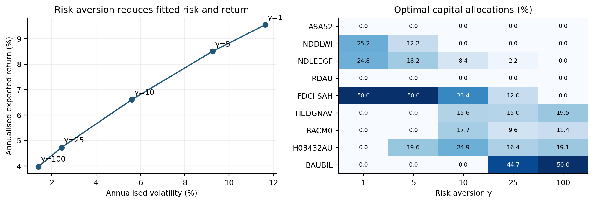
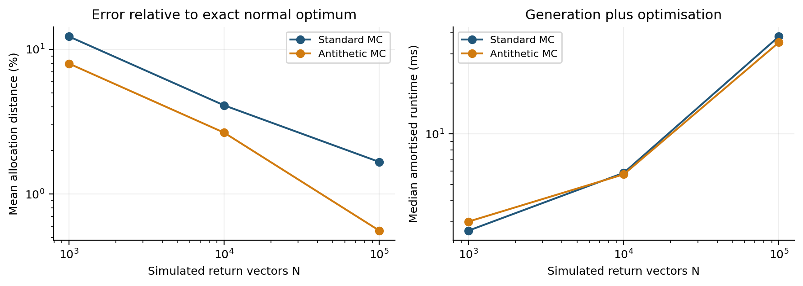
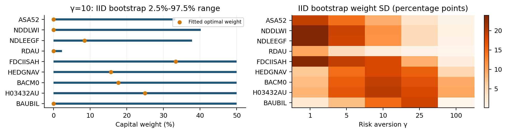

# Question 4: Utility, Monte Carlo and Portfolio Uncertainty

Priority 1 - Essential: Include to answer Q4(a)-(c), justify the model and explain the conclusions.

Priority 2 - Supporting evidence: Include if space permits; otherwise summarise or move to an appendix.

Priority 3 - Optional detail: Keep in the repository or appendix unless additional space is available.

| Report item | Priority |
| --- | ---: |
| Return horizon, Q1 inputs, constraints and utility objective | 1 |
| Full derivation of the normal-model utility formula | 2 |
| Risk-aversion values and their justification | 1 |
| Optimal allocations, expected returns, volatility and interpretation | 1 |
| Figure 1: risk-aversion outcomes and allocation heatmap | 2 |
| Monte Carlo methods, sample sizes and accuracy measures | 1 |
| Stable numerical objective and gradient details | 2 |
| Monte Carlo accuracy, runtime and benchmark comparison | 1 |
| Figure 2 and detailed gamma-by-gamma Monte Carlo comparison | 2 |
| Historical bootstrap design and re-estimation procedure | 1 |
| Bootstrap allocation uncertainty and interpretation | 1 |
| Figure 3: bootstrap uncertainty visualisation | 2 |
| Moving-block bootstrap experiment | 3 |
| Bootstrap replication-count check | 2 |
| Main conclusion and modelling limitations | 1 |
| Detailed numerical checks, coverage checklist and handover | 3 |

## Model and modelling choices [Priority 1]

Question 4 investigates how an investor’s attitude toward risk affects their optimal portfolio and how reliable that portfolio is. Part (a) finds the optimal allocations for different levels of risk aversion. Part (b) checks whether Monte Carlo simulation can reproduce those solutions accurately and efficiently. Part (c) uses historical bootstrap samples to examine how much the optimal weights change when estimated returns and covariances change. Together, these parts help us understand both which portfolio suits a given risk preference and how much confidence we should place in its estimated weights. The portfolios are fully invested, short selling is excluded, and each index has a 50% allocation limit.

### Return horizon and utility [Priority 1]

We model returns over one year using a normal distribution,

$$
R\sim N(m,C)
$$

Using Q1’s annualised estimates,

$$
m=12\times\text{average monthly return}
$$

$$
C=12\times\text{sample monthly covariance matrix}
$$

This arithmetic approximation does not account for compounding or dependence between returns in different months.

### Supporting utility derivation [Priority 2]

The investor has initial wealth $W_0$ = 1, terminal wealth:

$$
W_1=1+x^\top R
$$

and exponential utility:

$$
U(W)=-\exp(-\gamma W)
$$

Under the normal return model:

$$
\mathbb E[U(W_1)]=-\exp\!\left[-\gamma(1+x^\top m)+\frac{\gamma^2}{2}x^\top Cx\right]
$$

Maximising expected utility is therefore equivalent to maximising:

$$
f_\gamma(x)=x^\top m-\frac{\gamma}{2}x^\top Cx
$$

The first term is expected portfolio return. The second is the variance penalty, weighted by risk aversion.

The certainty-equivalent return is the guaranteed return an investor would consider equally attractive to the risky portfolio. Under our model: $$
f_\gamma(x)=\text{expected return}-\frac{\gamma}{2}\times\text{variance}
$$

For example, if  $f_\gamma(x)$  = 0.05, the investor considers the risky portfolio equally attractive to a guaranteed 5% return. Since initial wealth is 1, certainty-equivalent final wealth is 1 +  $f_\gamma(x)$ .

A larger $\gamma$ gives a larger risk penalty, lowering the certainty equivalent of the same portfolio. Utility comparisons between portfolios should use the same $\gamma$ because changing $\gamma$ changes the investor’s preferences.

### Choosing the risk-aversion range [Priority 1]

We use $\gamma$ = 1, 5, 10, 25 and 100 to represent different levels of risk aversion. These values were selected after testing a wider range and show how allocations shift from higher-return assets toward lower-risk assets as risk aversion increases. They illustrate different investor preferences rather than identify a single best $\gamma$.

## Q4(a): Optimal portfolios under different risk aversion [Priority 1]

As C is positive definite and $\gamma$ > 0, the objective is strictly concave. For each $\gamma$, the model has a unique optimal portfolio. We calculate its weights numerically and check that they satisfy the full-investment, no-short-selling and 50% cap constraints, as well as the conditions for optimality.

| Risk aversion $\gamma$ | Expected annual return | Annual volatility | CE return |
| --- | ---: | ---: | ---: |
| 1 | 9.551% | 11.623% | 8.876% |
| 5 | 8.510% | 9.252% | 6.371% |
| 10 | 6.611% | 5.609% | 5.038% |
| 25 | 4.732% | 2.441% | 3.987% |
| 100 | 3.982% | 1.398% | 3.004% |

### Portfolio allocations [Priority 1]

| Index | $\gamma$ = 1 | $\gamma$ = 5 | $\gamma$ = 10 | $\gamma$ = 25 | $\gamma$ = 100 |
| --- | ---: | ---: | ---: | ---: | ---: |
| ASA52 | 0.00% | 0.00% | 0.00% | 0.00% | 0.00% |
| NDDLWI | 25.22% | 12.24% | 0.00% | 0.00% | 0.00% |
| NDLEEGF | 24.78% | 18.20% | 8.43% | 2.20% | 0.00% |
| RDAU | 0.00% | 0.00% | 0.00% | 0.00% | 0.00% |
| FDCIISAH | 50.00% | 50.00% | 33.35% | 12.00% | 0.00% |
| HEDGNAV | 0.00% | 0.00% | 15.64% | 15.02% | 19.48% |
| BACM0 | 0.00% | 0.00% | 17.65% | 9.63% | 11.39% |
| H03432AU | 0.00% | 19.56% | 24.92% | 16.40% | 19.13% |
| BAUBIL | 0.00% | 0.00% | 0.00% | 44.75% | 50.00% |

**Figure 1 - Priority 2**

### Interpretation [Priority 1]

At $\gamma$ = 1, the optimal portfolio combines NDDLWI, NDLEEGF and a 50% holding in FDCIISAH. As risk aversion rises, lower-risk assets enter and both fitted return and volatility fall.

At $\gamma$ = 25, BAUBIL receives approximately 44.75%. At $\gamma$ = 100, it reaches its 50% cap. The latter portfolio’s volatility, 1.398%, is close to capped GMV’s 1.383%. However, utility optimisation still rewards expected return and therefore does not produce exactly the GMV weights.

The outcome follows the trade-off in  $f_\gamma$  where a larger $\gamma$ places more weight on variance. These portfolios are optimal conditional on the model, estimated inputs and preference value. They are not universally optimal investment recommendations.

## Q4(b): Numerical expected-utility optimisation [Priority 1] 

### Monte Carlo implementation [Priority 1]

For each experiment, we generate one-year arithmetic return vectors using the Cholesky factor L of C:

$$
R^{(k)}=m+LZ^{(k)},\qquad Z^{(k)}\sim N(0,I)
$$

where m represents estimated expected returns, $Z^{(k)}$ represents independent random normal shocks, and L, calculated from C, transforms those shocks so the simulated assets have the required risks and correlations.

The Monte Carlo simulated expected utility is therefore: $$
\widehat{\mathbb E[U(W_1)]}=-e^{-\gamma}\frac1N\sum_{k=1}^{N}e^{-\gamma x^\top R^{(k)}}
$$

We then determine the portfolio weights that maximise this simulated average utility, subject to the same portfolio constraints as Q4(a).

### Stable numerical objective [Priority 2]

Maximising expected utility is equivalent to minimising the following objective:

$$
h_N(x)=\frac1\gamma\log\!\left[\frac1N\sum_{k=1}^{N}e^{-\gamma x^\top R^{(k)}}\right]
$$

We evaluate this using log-sum-exp for numerical stability. Its gradient is the negative return mean under exponential weights.

This solves the sampled expected-utility problem directly. It does not replace that problem with a sample mean-variance approximation.

### Simulation procedure [Priority 1]

Return draws remain fixed throughout each optimisation, making the objective smooth and reproducible. Each run starts from equal weights rather than the exact benchmark.

We also compare standard Monte Carlo with the toolbox’s antithetic method, using paired shocks to reduce simulation variance:

$$
m+LZ\qquad\text{and}\qquad m-LZ
$$

N counts the total number of return vectors. Therefore, antithetic Monte Carlo uses N/2 independent pairs.

Samples are shared across the five preference scenarios within an experiment and are not redrawn at every solver evaluation.

### Experimental choices and accuracy measures [Priority 1]

We test:

$$
N=1{,}000,\ 10{,}000,\ 100{,}000
$$

Each method and sample size uses eight independent replications. This tenfold ladder tests the accuracy-cost trade-off rather than selecting one unexplained simulation count.

The fixed seed is 388804. Separate child streams are used for Monte Carlo, ordinary bootstrap and block bootstrap.

Allocation distance measures how differently capital is allocated compared with the benchmark. It was calculated using:

$$
D(x,\hat x)=\frac12\sum_i|x_i-\hat x_i|
$$

This is the fraction of capital allocated differently. It is not realised trading turnover.

We also evaluate each Monte Carlo portfolio under the exact original normal model, using the certainty-equivalent loss, which measures the reduction in CE return from using the Monte Carlo allocation instead of the benchmark:

$$
\text{CE loss}=f_\gamma(x^*)-f_\gamma(\hat x)\ge0
$$

Here, $x^*$ is the exact benchmark allocation and $\hat x$ is the Monte Carlo allocation.

This avoids judging a simulated portfolio only by its optimised in-sample utility. One basis point of CE return equals 0.0001.

The exported results also report CE estimation error and relative expected-utility error at the fixed exact benchmark.

### Numerical accuracy and computational performance [Priority 1]

The following summaries give each risk-aversion scenario equal representation. Allocation distance and CE loss are means over the five scenarios and eight replications. Timing is the median across those runs.

| Method | N | Mean allocation distance | Mean CE loss (bp) | Median time (ms) |
| --- | ---: | ---: | ---: | ---: |
| Antithetic | 1,000 | 7.97% | 1.157 | 3.00 |
| Antithetic | 10,000 | 2.65% | 0.087 | 5.74 |
| Antithetic | 100,000 | 0.56% | 0.008 | 35.03 |
| Standard | 1,000 | 12.25% | 1.758 | 2.65 |
| Standard | 10,000 | 4.10% | 0.202 | 5.85 |
| Standard | 100,000 | 1.67% | 0.044 | 37.99 |

**Figure 2 - Priority 2**

The results show that:

- Larger samples reduced aggregate allocation error and CE loss.
- Antithetic sampling improved aggregate accuracy in this experiment.

At N = 100,000, mean allocation distance is 1.67% for standard Monte Carlo and 0.56% for antithetic Monte Carlo. Mean exact-model CE loss is 0.044 bp and 0.008 bp, respectively.

### Detailed comparison by risk aversion [Priority 2]

The scenario-level comparison at N = 100,000 is:

| Risk aversion $\gamma$ | Standard distance | Antithetic distance | Standard CE loss (bp) | Antithetic CE loss (bp) |
| --- | ---: | ---: | ---: | ---: |
| 1 | 3.01% | 0.37% | 0.0799 | 0.0012 |
| 5 | 1.78% | 0.53% | 0.0630 | 0.0137 |
| 10 | 2.15% | 0.95% | 0.0511 | 0.0133 |
| 25 | 1.10% | 0.68% | 0.0215 | 0.0071 |
| 100 | 0.29% | 0.27% | 0.0037 | 0.0038 |

### Interpretation and benchmark comparison [Priority 1]

Allocation error and economic objective error need not move together: nearby portfolios can have almost the same utility. Consequently, both metrics are needed.

In this experiment, N = 100,000 provides the most accurate tested aggregate approximation, at higher computational cost (longer time taken). Eight replications give a limited assessment of simulation variability, not a universal accuracy guarantee.

The exact quadratic benchmark takes approximately 0.80-1.33 ms per solve. Antithetic Monte Carlo at N = 100,000 takes approximately 23-39 times longer for the solver alone.

Timings use one BLAS thread, exclude file input/output, and are machine-specific. Benchmark timing is the median of 30 solves per scenario. Monte Carlo timings include reoptimisation from equal weights.

Ultimately, for this normal/exponential-utility problem, the mean-variance benchmark is preferable because it uses the exact mean-variance reduction for the stated model, solved numerically under the constraints, and is computationally less costly. Monte Carlo provides a numerical validation here and becomes useful when an analytical reduction is unavailable.

## Q4(c): Historical sampling uncertainty [Priority 1] 

### Resampling design [Priority 1]

We create each bootstrap sample by randomly selecting 248 historical months with replacement. All nine returns from a sampled month stay together, preserving their relationship within that month. For each sample, we re-estimate both the monthly mean and covariance, applying Q1’s annualisation of mean and covariance, and optimise the portfolio again for every $\gamma$ value.

We do not resample assets independently or hold the covariance matrix fixed.

We use 10,000 independent and identically distributed (IID) resamples, following a smaller pilot in which some tail endpoints changed substantially.

At this count, the Monte Carlo standard error of an estimated selection probability is at most 0.5 percentage points, and each 2.5% tail contains approximately 250 observations. Weight percentiles can nevertheless remain unstable when many allocations are exactly zero or at the 50% cap. We therefore compare 5,000 with 10,000 replications separately below.

The 2.5%-97.5% marginal ranges describe the resampled allocation distribution under the chosen resampling scheme. They are not future-return predictions or a joint confidence region for the portfolio. Combining their endpoints does not necessarily produce weights that sum to 100%.

### Allocation stability across preferences [Priority 1]

| Risk aversion $\gamma$ | Median allocation distance | 95th percentile distance | Largest weight SD (percentage points) |
| --- | ---: | ---: | ---: |
| 1 | 40.15% | 75.22% | 23.96 |
| 5 | 41.78% | 81.80% | 19.42 |
| 10 | 48.30% | 73.92% | 19.82 |
| 25 | 35.74% | 63.03% | 18.62 |
| 100 | 10.14% | 20.19% | 9.77 |

For $\gamma$ = 10, median allocation distance is 48.30%, meaning that the median bootstrap portfolio allocates 48.30% of capital differently from the original portfolio, with a 95th percentile of 73.92%.

At $\gamma$ = 100, the median distance is much smaller, approximately 10.14%, although significant uncertainty remains.

Higher risk aversion is not uniformly more stable. The intermediate mixed portfolios are particularly sensitive to estimated means and covariances.

Now examining the portfolio specifically for $\gamma$ = 10, the marginal allocation ranges are:

| Index | Fitted weight | Bootstrap mean | 2.5th percentile | 97.5th percentile |
| --- | ---: | ---: | ---: | ---: |
| ASA52 | 0.00% | 3.77% | 0.00% | 33.22% |
| NDDLWI | 0.00% | 6.65% | 0.00% | 40.15% |
| NDLEEGF | 8.43% | 8.64% | 0.00% | 37.83% |
| RDAU | 0.00% | 0.26% | 0.00% | 2.31% |
| FDCIISAH | 33.35% | 25.35% | 0.00% | 50.00% |
| HEDGNAV | 15.64% | 12.88% | 0.00% | 50.00% |
| BACM0 | 17.65% | 16.64% | 0.00% | 50.00% |
| H03432AU | 24.92% | 18.14% | 0.00% | 50.00% |
| BAUBIL | 0.00% | 7.65% | 0.00% | 50.00% |

FDCIISAH’s fitted weight is 33.35%, while H03432AU’s is 24.92%. Both have bootstrap ranges extending from zero to 50%.

Similarly, an asset receiving zero weight in the original portfolio may receive a positive allocation in other samples.

This distinction between a unique fitted optimum and an uncertain estimated optimum is central to Q4(c).

### Visual uncertainty [Priority 2]

### Independence limitation [Priority 1]

The ordinary bootstrap treats months as independent. However, returns may be related across consecutive months. The observed lag-one correlations are approximately 0.982 for BAUBIL and 0.219 for HEDGNAV, so this assumption is a limitation.

### Moving-block sensitivity experiment [Priority 3]

As a sensitivity check, we resample joint moving blocks of 6, 12 and 24 months. We sample valid historical block starts uniformly, concatenate the blocks, and truncate the resulting sample to 248 rows.

This preserves dependence within each block while retaining the same estimation and optimisation conventions. Twelve months matches the one-year stated model. Six and 24 months test shorter and longer dependence retention. These are transparent sensitivity choices, not an estimated optimal block length.

Each length uses 1,000 replications, so block results are coarser than the primary IID experiment. This is an additional historical-bootstrap sensitivity check, not a replacement of the assignment’s normal return model or Q1 covariance convention.

Median allocation distances are:

| Risk aversion $\gamma$ | IID months | 6-month blocks | 12-month blocks | 24-month blocks |
| --- | ---: | ---: | ---: | ---: |
| 1 | 40.15% | 29.16% | 43.25% | 27.19% |
| 5 | 41.78% | 40.12% | 43.59% | 40.59% |
| 10 | 48.30% | 47.66% | 48.71% | 47.62% |
| 25 | 35.74% | 36.09% | 40.23% | 38.85% |
| 100 | 10.14% | 10.05% | 9.90% | 9.40% |

The intermediate allocations remain highly uncertain under every resampling scheme. For $\gamma$ = 10, the 12-month-block median distance is approximately 48.71%, close to the IID value.

The schemes do not produce identical distributions, and block resampling does not mechanically increase every uncertainty measure. Their agreement on substantial instability is more useful than treating a particular interval endpoint as exact.

### Replication-count check [Priority 2]

Comparing the first 5,000 IID resamples with all 10,000 gives:

| Risk aversion $\gamma$ | Maximum mean-weight change (percentage points) | Maximum percentile-endpoint change (percentage points) |
| --- | ---: | ---: |
| 1 | 0.24 | 8.46 |
| 5 | 0.26 | 1.71 |
| 10 | 0.42 | 1.16 |
| 25 | 0.25 | 0.49 |
| 100 | 0.09 | 0.17 |

The largest mean-weight change is approximately 0.42 percentage points. Some low-risk-aversion tail endpoints still move appreciably because of mixtures of zero, interior and capped allocations. In particular, the largest endpoint change at $\gamma$ = 1 is approximately 8.46 percentage points.

We report these ranges approximately and do not claim that every endpoint has stabilised. Additional resampling would reduce simulation noise, but would not add historical information or eliminate model uncertainty.

## Interpretation and conclusion [Priority 1]

Q4 identifies three distinct effects.

Risk aversion changes the trade-off between fitted return and risk. Monte Carlo approximates a fixed normal-model optimum and introduces controllable simulation error. Historical resampling changes the estimated inputs and exposes much larger uncertainty in the resulting allocations.

Increasing the Monte Carlo sample size cannot remove historical estimation uncertainty.

The 50% cap remains useful as the group’s chosen capital-concentration policy, but does not stabilise all optimal weights.

The results do not determine an investor’s preferred $\gamma$, establish future outperformance, or validate the normal model’s tails. Q1’s currency and index-definition qualifications and its arithmetic annualisation convention remain relevant.

Block resampling addresses some within-block dependence in parameter uncertainty. It does not address the assumption that the one-year covariance equals 12 times the monthly covariance.

## Numerical checks [Priority 3]

All 65,245 primary benchmark, Monte Carlo, IID-bootstrap and block-bootstrap solutions passed the stated checks.

The largest constraint violation was $5.44\times10^{-12}$. The largest convex optimality-gap certificate was $6.09\times10^{-8}$, below the $10^{-7}$ threshold.

Risk and expected return were non-increasing across the selected risk-aversion values. Monte Carlo portfolios did not exceed the exact normal-model optimum when evaluated under the original parameters.

The normal utility formula, certainty-equivalent transformation and stable sampled objective were independently checked.

All bootstrap covariance matrices were generated from complete joint samples using the same sample-covariance convention. Simulation seeds, timing conventions, bootstrap indices, parameter estimates, allocation distributions and representative simulated asset-return samples are retained with the code.

## Assignment and checkpoint coverage [Priority 3]

| Requirement | Completed evidence |
| --- | --- |
| Q4(a): several risk-aversion choices; allocations, return and risk | Five scenarios, allocation table, risk-return table and Figure 1; design sweep retained. |
| Q4(b): numerical expected utility; benchmark, accuracy and performance | Standard/antithetic MC, three sample sizes, eight replications, exact-model CE losses, timing and Figure 2. |
| Q4(c): historical bootstrap and allocation reliability | Joint-row bootstrap, weight ranges and boundary frequencies, block sensitivity, replication check and Figure 3. |
| Checkpoint D2: retain model and reproducibility interface | m/C, horizon, constraints, gammas, seeds, samples, bootstrap indices/weights/moments and code exported. |

## Downstream handover [Priority 3]

Q5 can continue independently using the Q3 strategic growth targets.

Q6 must justify its own risk-aversion and tactical choices. Q4’s five scenarios provide sensitivity evidence rather than an automatic value to inherit.

Extension A can refer to the normal baseline and uncertainty results, while still requiring the original historical return matrix and its own risk-model investigation.

For the combined 8-10 page group report, prioritise the risk-aversion outcomes, a compact Monte Carlo accuracy/time comparison, and the bootstrap uncertainty conclusion. Keep the full simulation tables, diagnostic settings and block-length checks in an appendix or repository when space is limited.

## Sources

Supplied project instructions, Q4(a)-(c); supplied Q4/Q5 checkpoint; current Q1 exports and Q2 baseline in the uploaded group repository; supplied Method Toolbox.

The assignment itself is not claimed to impose a short-selling ban or a 50% asset cap.
